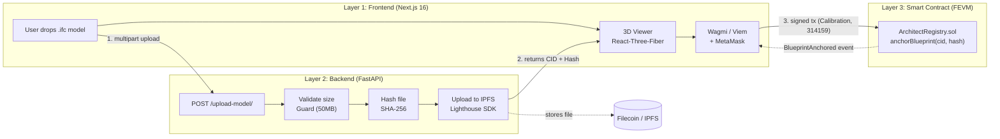

# The Onchain Architect

An open-source starter kit for storing 3D architectural models (`.ifc`, `.gltf`) on Filecoin and anchoring their proofs on FEVM.

## The Problem & The Idea

3D building blueprints are heavy files (often tens to hundreds of megabytes). They are too large to store directly on an EVM smart contract, so in practice they usually sit in email threads, shared drives, or proprietary platforms. When revisions are approved or disputes arise years later during construction, it's hard to prove which version of a file was finalized at a specific time.

This project connects Filecoin's decentralized storage with FEVM contracts to create a simple audit trail:

- **Heavy files live on Filecoin/IPFS:** Uploads are pinned to IPFS and backed by Filecoin storage deals through the Lighthouse SDK.
- **Dual fingerprinting:** The backend computes a SHA-256 hash of the exact file bytes alongside the IPFS CID to ensure tamper evidence.
- **Proof anchored on FEVM:** The smart contract (`ArchitectRegistry.sol`) records the CID, hash, and timestamp on the Filecoin Calibration testnet under your wallet address.

## 📺 Demo Video

[▶ Watch the 3-minute End-to-End Demo on Loom](https://loom.com) *(Walkthrough video)*

The video shows the full workflow: uploading an `.ifc` model in the UI, backend validation and hashing, IPFS upload via Lighthouse, and the MetaMask-signed `anchorBlueprint(cid, hash)` transaction on the Filecoin Calibration testnet.

## Features

- Drag-and-drop `.ifc` and `.gltf` upload with a 3D wireframe preview (React-Three-Fiber).
- SHA-256 cryptographic hashing and IPFS CID generation.
- Decentralized storage through the Lighthouse Python SDK.
- On-chain record anchoring via `anchorBlueprint(cid, hash)` on Filecoin Calibration (Chain ID 314159).
- Clean wallet switching and network guardrails with Wagmi and Viem.
- Modular, decoupled architecture so each piece can be run and tested independently.

## Architecture

The system has three decoupled layers. The backend doesn't know about wallets, and the smart contract doesn't store the raw file:



### How Verification Works

1. The backend receives the file and computes its SHA-256 hash in memory.
2. The file is uploaded to IPFS through Lighthouse, which produces an immutable CID.
3. Your wallet calls `anchorBlueprint(cid, hash)` on the smart contract.
4. Anyone who downloads the model in the future can re-hash it and check that it matches what was anchored on-chain.

## Repository Structure

```text
the-onchain-architect/
├── frontend/        # Next.js 16, Tailwind, React-Three-Fiber, Wagmi/Viem
├── backend/         # FastAPI, IfcOpenShell POC, Lighthouse SDK
├── contracts/       # Hardhat v3, Solidity 0.8.24, Ignition deployment modules
├── CONTRIBUTING.md  # Contributor guidelines and workflow
├── LICENSE          # MIT License
└── README.md        # Monorepo architecture & setup guide
```

## Local Setup Guide

### Prerequisites

- Node.js ≥ 20 and npm
- Python ≥ 3.10
- MetaMask browser extension
- A Lighthouse API key (available at [files.lighthouse.storage](https://files.lighthouse.storage/))
- A funded Calibration testnet wallet (get tFIL from the [Calibration faucet](https://faucet.calibnet.chainsafe-fil.io/))

> **Never commit `.env` files or private keys.** Use a dedicated throwaway wallet for testnet work.

```bash
git clone https://github.com/tahabayati/the-onchain-architect.git
cd the-onchain-architect
```

### 1. Smart contracts (Hardhat v3 + FEVM)

The registry contract is already live on Filecoin Calibration at `0xE91f75b580d1aF8CaFA42cB7d4Bf17830666112c`, so you can run the app immediately without deploying your own.

To run the contract test suite:

```bash
cd contracts
npm install
npm test
```

If you do want to deploy your own copy to Calibration, copy `.env.example` to `.env` with a throwaway `PRIVATE_KEY` and run:

```bash
npm run compile
npm run deploy:calibration
```

*(If you deploy a new contract, set `NEXT_PUBLIC_ARCHITECT_REGISTRY_ADDRESS` in `frontend/.env.local` to point to it).*

### 2. Backend (FastAPI)

```bash
cd backend
python3 -m venv venv
source venv/bin/activate
pip install -r requirements.txt
```

Create `backend/.env`:

```env
LIGHTHOUSE_API_KEY=your_lighthouse_api_key
```

Start the API:

```bash
uvicorn main:app --reload
```

The API is served at `http://localhost:8000` (interactive docs at `/docs`).

### 3. Frontend (Next.js)

```bash
cd frontend
npm install
npm run dev
```

Open [http://localhost:3000](http://localhost:3000). The frontend connects to the backend at `http://localhost:8000` by default. You can override this with `NEXT_PUBLIC_API_URL` in `frontend/.env.local`.

### 4. End-to-end smoke test

1. Connect MetaMask to the Filecoin Calibration network (chain ID 314159).
2. Drop a valid `.ifc` file into the upload zone.
3. Wait for the CID and SHA-256 hash to appear.
4. Click **Anchor** and confirm the MetaMask transaction.
5. Verify the transaction on [Calibration Filfox](https://calibration.filfox.info).

## Troubleshooting

### RPC issues: Chainlist fails for Filecoin Calibration

If adding the network through Chainlist fails or hangs, add it manually in MetaMask (Settings → Networks → Add network manually) using the Glif RPC:

| Field | Value |
| --- | --- |
| Network name | Filecoin Calibration |
| RPC URL | `https://api.calibration.node.glif.io/rpc/v1` |
| Chain ID | 314159 |
| Currency symbol | tFIL |
| Block explorer | `https://calibration.filfox.info` |

### Hardhat v3 ESM errors: `Task ignition not found` or `Invalid discriminator value`

If `npx hardhat ignition deploy` fails with either message:

1. **Declare the network type.** Hardhat v3 requires `type: "http"` on remote networks in `contracts/hardhat.config.ts`:

   ```typescript
   import hardhatToolboxViemPlugin from "@nomicfoundation/hardhat-toolbox-viem";
   import { defineConfig } from "hardhat/config";
   import * as dotenv from "dotenv";

   dotenv.config();

   export default defineConfig({
     plugins: [hardhatToolboxViemPlugin],
     solidity: "0.8.24",
     defaultNetwork: "calibration",
     networks: {
       calibration: {
         type: "http",
         chainType: "l1",
         chainId: 314159,
         url: "https://api.calibration.node.glif.io/rpc/v1",
         accounts: process.env.PRIVATE_KEY ? [process.env.PRIVATE_KEY] : [],
       },
     },
   });
   ```

2. **Delete unused template files.** Default files like `contracts/Counter.sol` can conflict with the 0.8.24 compiler. Remove them and recompile:

   ```bash
   rm -f contracts/contracts/Counter.sol contracts/test/Counter.ts ignition/modules/Counter.ts
   npx hardhat compile
   ```

### Wagmi / MetaMask Chain ID mismatch (1 vs 314159)

If the UI shows a "Chain ID mismatch (1 vs 314159)" error after you switch networks, Wagmi is holding stale connection state in the Next.js client cache:

1. Disconnect the wallet on the site using the app's disconnect button.
2. Refresh the page.
3. Reconnect the wallet.

## What's Next

This repository is currently a functional reference prototype. Next steps for the project:

- **Milestone 1:** Full IFC schema and geometry parsing via native `ifcopenshell` (inspecting walls, geometry, and storeys before upload).
- **Milestone 2:** Chunked large-file streaming for 500MB+ production models.
- **Milestone 3:** Filecoin deal status tracking directly in the web UI.
- **Milestone 4:** Multi-signer approvals for architectural revision sign-offs.

## License

Released under the [MIT License](./LICENSE).
