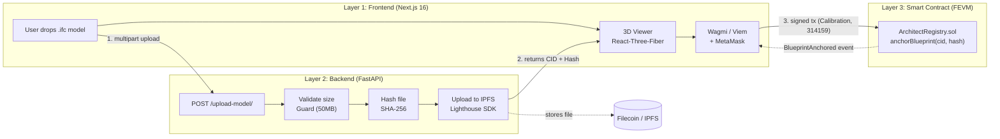

# The Onchain Architect

[](https://github.com/tahabayati/the-onchain-architect/actions/workflows/ci.yml)

An open-source starter kit for storing 3D architectural models (`.ifc`, `.gltf`) on Filecoin and anchoring their proofs on FEVM.

## Problem and idea

3D building models are large, often tens to hundreds of megabytes, which is far too big to store in an EVM smart contract. In practice they end up in email threads, shared drives, or proprietary platforms. Years later, when a revision is disputed during construction, it is hard to prove which version of a file was approved and when.

This project keeps the file off-chain and puts a fingerprint of it on-chain:

- The file is uploaded to IPFS through the Lighthouse SDK. Lighthouse handles the Filecoin storage side; this repo does not track deal status yet (see What's next).
- The backend computes a SHA-256 hash of the exact bytes it received. The upload also returns an IPFS CID. Either one lets you check later that a file is unchanged.
- The contract (`ArchitectRegistry.sol`) records the CID, the hash and a timestamp under your wallet address on the Filecoin Calibration testnet.

## Demo

A live demo connected to the Calibration testnet runs at [onchain.tahabayati.dev](https://onchain.tahabayati.dev).

A recorded walkthrough has not been added yet. It will cover uploading an `.ifc` model, the backend size check and hashing, the IPFS upload through Lighthouse, and the MetaMask-signed `anchorBlueprint(cid, hash)` transaction on Calibration.

## Features

- Drag-and-drop `.ifc` and `.gltf` upload with a 3D wireframe preview (React-Three-Fiber).
- SHA-256 hashing of the uploaded bytes, plus the IPFS CID returned by Lighthouse.
- Upload to IPFS through the Lighthouse Python SDK.
- On-chain record anchoring via `anchorBlueprint(cid, hash)` on Filecoin Calibration (Chain ID 314159).
- Wallet connection with Wagmi and Viem, and a prompt to switch to Calibration if the wallet is on another network.
- Frontend, backend and contracts each run and test on their own.

## Architecture

The system has three decoupled layers. The backend doesn't know about wallets, and the smart contract doesn't store the raw file:



### How verification works

1. The backend receives the file and computes its SHA-256 hash in memory.
2. The file is uploaded to IPFS through Lighthouse, which returns the CID.
3. Your wallet calls `anchorBlueprint(cid, hash)` on the smart contract.
4. Anyone who downloads the model in the future can re-hash it and check that it matches what was anchored on-chain.

## Repository structure

```text
the-onchain-architect/
├── frontend/        # Next.js 16, Tailwind, React-Three-Fiber, Wagmi/Viem
├── backend/         # FastAPI, IfcOpenShell POC, Lighthouse SDK
├── contracts/       # Hardhat v3, Solidity 0.8.24, Ignition deployment modules
├── CONTRIBUTING.md  # Contributor guidelines and workflow
├── LICENSE-MIT      # MIT License
├── LICENSE-APACHE   # Apache License 2.0
└── README.md        # Monorepo architecture & setup guide
```

## Local setup

### Prerequisites

- Node.js ≥ 20 and npm
- Python ≥ 3.10
- MetaMask browser extension
- A Lighthouse API key (available at [files.lighthouse.storage](https://files.lighthouse.storage/))
- A funded Calibration testnet wallet (get tFIL from the [Calibration faucet](https://faucet.calibnet.chainsafe-fil.io/))

> **Never commit `.env` files or private keys.** Use a dedicated throwaway wallet for testnet work.

```bash
git clone https://github.com/tahabayati/the-onchain-architect.git
cd the-onchain-architect
```

### 1. Smart contracts (Hardhat v3 + FEVM)

The registry contract is already live on Filecoin Calibration at `0xE91f75b580d1aF8CaFA42cB7d4Bf17830666112c`, so you can run the app immediately without deploying your own.

To run the contract test suite:

```bash
cd contracts
npm install
npm test
```

If you do want to deploy your own copy to Calibration, copy `.env.example` to `.env` with a throwaway `PRIVATE_KEY` and run:

```bash
npm run compile
npm run deploy:calibration
```

*(If you deploy a new contract, set `NEXT_PUBLIC_ARCHITECT_REGISTRY_ADDRESS` in `frontend/.env.local` to point to it).*

### 2. Backend (FastAPI)

```bash
cd backend
python3 -m venv venv
source venv/bin/activate
pip install -r requirements.txt
```

Create `backend/.env`:

```env
LIGHTHOUSE_API_KEY=your_lighthouse_api_key
```

Start the API:

```bash
uvicorn main:app --reload
```

The API is served at `http://localhost:8000` (interactive docs at `/docs`).

### 3. Frontend (Next.js)

```bash
cd frontend
npm install
npm run dev
```

Open [http://localhost:3000](http://localhost:3000). The frontend connects to the backend at `http://localhost:8000` by default. You can override this with `NEXT_PUBLIC_API_URL` in `frontend/.env.local`.

### 4. End-to-end smoke test

1. Connect MetaMask to the Filecoin Calibration network (chain ID 314159).
2. Drop a valid `.ifc` file into the upload zone.
3. Wait for the CID and SHA-256 hash to appear.
4. Click **Anchor** and confirm the MetaMask transaction.
5. Verify the transaction on [Calibration Filfox](https://calibration.filfox.info).

## Troubleshooting

### RPC issues: Chainlist fails for Filecoin Calibration

If adding the network through Chainlist fails or hangs, add it manually in MetaMask (Settings → Networks → Add network manually) using the Glif RPC:

| Field | Value |
| --- | --- |
| Network name | Filecoin Calibration |
| RPC URL | `https://api.calibration.node.glif.io/rpc/v1` |
| Chain ID | 314159 |
| Currency symbol | tFIL |
| Block explorer | `https://calibration.filfox.info` |

### Hardhat v3 ESM errors: `Task ignition not found` or `Invalid discriminator value`

If `npx hardhat ignition deploy` fails with either message:

1. Declare the network type. Hardhat v3 requires `type: "http"` on remote networks in `contracts/hardhat.config.ts`:

   ```typescript
   import hardhatToolboxViemPlugin from "@nomicfoundation/hardhat-toolbox-viem";
   import { defineConfig } from "hardhat/config";
   import * as dotenv from "dotenv";

   dotenv.config();

   export default defineConfig({
     plugins: [hardhatToolboxViemPlugin],
     solidity: "0.8.24",
     defaultNetwork: "calibration",
     networks: {
       calibration: {
         type: "http",
         chainType: "l1",
         chainId: 314159,
         url: "https://api.calibration.node.glif.io/rpc/v1",
         accounts: process.env.PRIVATE_KEY ? [process.env.PRIVATE_KEY] : [],
       },
     },
   });
   ```

2. Delete unused template files. Default files like `contracts/Counter.sol` can conflict with the 0.8.24 compiler. Remove them and recompile:

   ```bash
   rm -f contracts/contracts/Counter.sol contracts/test/Counter.ts ignition/modules/Counter.ts
   npx hardhat compile
   ```

### Wagmi / MetaMask Chain ID mismatch (1 vs 314159)

If the UI shows a "Chain ID mismatch (1 vs 314159)" error after you switch networks, Wagmi is holding stale connection state in the Next.js client cache:

1. Disconnect the wallet on the site using the app's disconnect button.
2. Refresh the page.
3. Reconnect the wallet.

## What's next

This is a working prototype. Planned work:

1. Deeper IFC checks with `ifcopenshell`: geometry and element checks (walls, storeys). Today `backend/main.py` only confirms the file parses and reports its schema and entity count.
2. Chunked streaming for models of 500 MB and up. The upload limit is 50 MB today.
3. Filecoin deal status in the web UI.
4. Multi-signer approvals for revision sign-offs.

## License

The code is dual-licensed under either of

- [MIT License](./LICENSE-MIT)
- [Apache License, Version 2.0](./LICENSE-APACHE)

at your option.

Unless you state otherwise, any contribution you submit for inclusion in this project is dual-licensed as above, with no additional terms or conditions.
